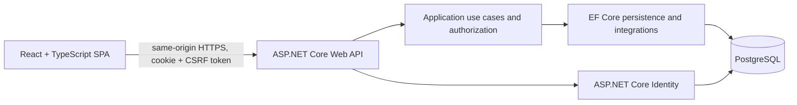

# Architecture

## Decision status

The product brief confirms a modular monolith, ASP.NET Core, EF Core, PostgreSQL, Identity, cookie authentication, and a React SPA. The initial solution, API, client, and base dependencies now exist. Tenant controls and business modules remain incomplete; see [implementation status](./implementation-status.md).

## Runtime shape



**Recommended deployment shape:** serve the SPA and API under one origin (for example, reverse-proxy `/api` to ASP.NET Core). This keeps the browser cookie model straightforward. A separate API origin is not selected; if later required, revisit CORS, credentialed requests, cookie policy, and CSRF controls together.

## Project boundaries

Start with three production projects and a test project:

```text
server/
  PreschoolConnect.Api/             HTTP, middleware, authentication, composition
  PreschoolConnect.Application/     use cases, domain rules, authorization policies
  PreschoolConnect.Infrastructure/  EF Core, PostgreSQL, Identity persistence
  PreschoolConnect.Tests/           unit and focused integration tests
client/
  src/app/                           routing and application composition
  src/features/{students,classes,attendance,daily-reports,announcements,parent-portal}/
  src/components/                    shared UI components
  src/lib/                           API client and cross-feature utilities
```

This avoids a separate Domain project before its value is clear while keeping HTTP, use cases, and persistence dependencies distinct. Organize by feature inside these boundaries. Split a domain project only when independent domain reuse or compile-time isolation justifies it.

Dependency direction: API → Application; Infrastructure implements application-facing persistence/identity abstractions and is composed by API; Application does not depend on ASP.NET Core HTTP or EF Core. Frontend API calls and server-state behavior stay behind the client feature/lib boundary.

Do not introduce Generic Repository, Unit of Work, CQRS, MediatR, a DI container, microservices, queues, or a migration framework beyond EF Core migrations by default. Add a pattern only for a concrete problem.

## Modular monolith

Keep school management, enrollment, attendance, daily reports, announcements, membership/authorization, and audit as feature modules in one deployable application and database. Modules may share a transaction where a business operation requires it, but should access another module through explicit application contracts rather than arbitrary table writes.

## Tenant boundary

- A school owns every school-scoped business row. Include `SchoolId` on these rows.
- Resolve an active school membership server-side from the authenticated user. If a user belongs to several schools, an explicit selection is accepted only after the server verifies that membership.
- Parent scope is derived from the authenticated account's `StudentAccount` → `Student` → `School` relationship. Never authorize from a request-body `SchoolId` or `StudentId`.
- Use tenant-scoped application queries and authorization on every read/write. Add composite unique keys and composite foreign keys to prevent cross-school relationships.
- EF Core global query filters may reduce accidental omissions, but are not the sole security boundary: they can be bypassed and do not replace authorization or explicit scoped operations.
- PostgreSQL row-level security is a possible later defense-in-depth layer, not an MVP substitute. Table owners and roles with bypass privileges can bypass policies; pooled-connection context and migration roles require careful design.

## Authentication and authorization

Use ASP.NET Core Identity for user/password lifecycle, framework hashing, lockout, and token primitives. Use secure cookies for this same-origin web application. Authorization separately evaluates account status, school membership/role, class assignment, and the student account mapping. Roles are school-scoped membership grants, not global role claims as the only tenant boundary.

## Now / later / deferred

| Now in the design | Prepared, not built in the MVP | Deferred |
|---|---|---|
| School ownership on entities; server-resolved tenant context; Identity and cookie/CSRF plan; enrollment history; focused API/application/infrastructure boundaries; EF Core/PostgreSQL. | Shared-schema multi-school data, composite tenant keys, membership-based role resolution, tenant-isolation test strategy. | Tenant provisioning/billing, database-per-tenant, RLS as primary enforcement, distributed services, external notifications, private-media system, unrestricted agent database access. |

## Workspace boundary

PreschoolConnect is located in a sibling folder to `PersonalFinanceTracker` and is not part of that finance application's Git worktree. Keep their source, dependencies, instructions, and local data separate. Finance-specific SQLite/API assumptions do not apply to PreschoolConnect.

## References

- [ASP.NET Core Identity](https://learn.microsoft.com/en-us/aspnet/core/security/authentication/identity?view=aspnetcore-10.0)
- [EF Core global query filters](https://learn.microsoft.com/en-us/ef/core/querying/filters)
- [PostgreSQL row security](https://www.postgresql.org/docs/current/ddl-rowsecurity.html)
- [Npgsql EF Core provider](https://www.npgsql.org/efcore/)
- [Npgsql date/time handling](https://www.npgsql.org/doc/types/datetime.html)
