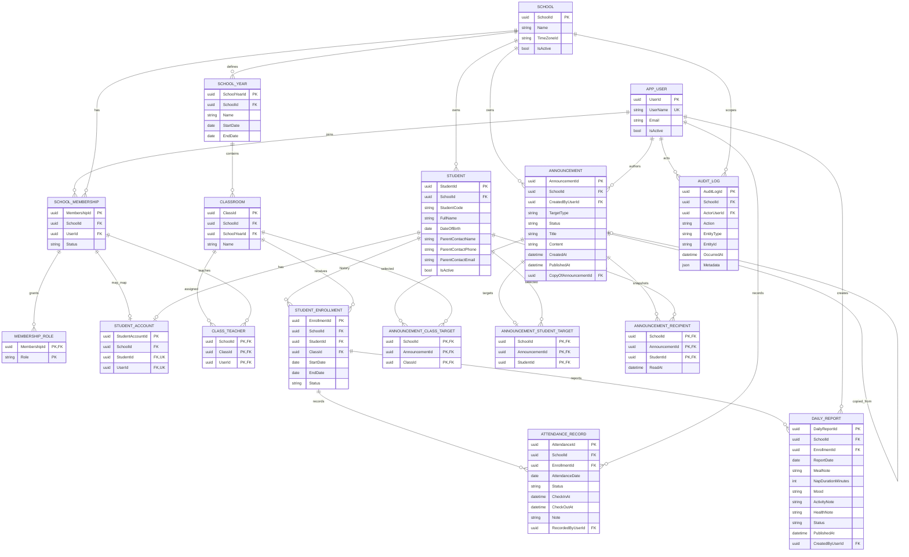

# Proposed Database ERD

**Status:** conceptual model for architecture review; not a migration or final schema. IDs are proposed UUIDs. Use PostgreSQL/EF Core constraints as well as application rules. All school-owned rows carry `SchoolId`; the composite keys below make school ownership part of relationships, not just a query convention.

## Keys and constraints to implement and test

- Identity user names/emails follow Identity's configured normalization and uniqueness rules.
- `SchoolMembership`: unique `(SchoolId, UserId)` and a composite key usable by child FKs. Role assignments are unique `(MembershipId, Role)`. Roles: `SchoolAdmin`, `Teacher`, `Parent`; do not rely on global roles for school authorization.
- `Student`: unique `(SchoolId, StudentId)` and `(SchoolId, StudentCode)`.
- `StudentAccount`: unique `StudentId` and unique `UserId` (one user maps to at most one student globally); composite FKs `(SchoolId, StudentId)` and `(SchoolId, UserId)` point to the same-school student and membership. Require the linked membership to have `Parent` role in the application and test it.
- `SchoolYear`: `EndDate > StartDate`; school-local date policy must be settled. `Classroom`: composite FK `(SchoolId, SchoolYearId)`; recommended unique `(SchoolYearId, Name)`.
- `ClassTeacher`: composite FKs to the same-school class and membership; unique `(SchoolId, ClassId, UserId)`.
- `StudentEnrollment`: composite FKs to same-school student and class; `EndDate` is exclusive and must be after `StartDate`. Transfers close the prior enrollment and create the next inside one transaction. Enforce non-overlapping student date ranges in PostgreSQL (a GiST exclusion constraint with `btree_gist` is a candidate) and validate the same invariant in application use cases. Confirm required extension/constraint approach before schema work.
- `AttendanceRecord`: unique `(EnrollmentId, AttendanceDate)`; status restricted to the MVP attendance set; checkout cannot precede check-in; date must fall within the enrollment's effective interval.
- `DailyReport`: unique `(EnrollmentId, ReportDate)`; `NapDurationMinutes >= 0`; parents can read published records only. Published corrections require explicit actor/time audit.
- `Announcement`: one `TargetType` (`School`, `Class`, `Student`) and matching target rows only; state/timestamps must be consistent. `CopyOfAnnouncementId` references the original without mutating it.
- `AnnouncementStudentTarget`: unique `(SchoolId, AnnouncementId)` so a student-targeted announcement selects exactly one student. `AnnouncementClassTarget` supports multiple classes. A school target has no rows in either target table. The cross-table relationship between `TargetType` and target rows needs one transactional publication/use-case path and tests; a row-level `CHECK` cannot enforce it by itself.
- `AnnouncementRecipient`: unique `(AnnouncementId, StudentId)`; rows are immutable membership snapshots except for `ReadAt`. All target and recipient relations include `SchoolId` in composite FKs.
- `AuditLog`: store a minimal allowlisted record; do not put passwords, tokens, full report text, or unnecessary child/parent data in metadata.

Proposed index strategy: indexes for tenant-leading lookup paths and common access patterns (for example `(SchoolId, AttendanceDate)`, `(SchoolId, StudentId, StartDate)`, `(SchoolId, Status)` only where measured). Unique and composite FK constraints are correctness controls, not just performance indexes. Review query plans before adding speculative indexes.

`School.TimeZoneId` is a proposed addition because calendar dates and instants have different semantics. Store school business dates as PostgreSQL `date`; store instants such as publication/check-in times in UTC `timestamptz`. Confirm the school time-zone and daylight-saving policy first.
